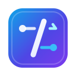

<div align="center">



# agy-cmd

**Google Antigravity plugin: smart auto-router · Stop-hook auto-retry guard · free-tier protection · live Sidecar panel**

[简体中文](README.zh-CN.md) · English · [How to Install](#how-to-install) · [Features](#features) · [CLI Management](#cli-management)

</div>

---

## What is agy-cmd?

`agy-cmd` is a workflow plugin for **Google Antigravity Desktop / IDE**.

Once installed, it runs automatically in the background during every chat to handle four things: routing tasks to the right Antigravity workflow by scope, automatically retrying fixes when tests or checks fail via a Stop hook, protecting free-tier accounts from paid-only slash commands, and providing a live right-hand Sidecar control panel.

## How to Install

Requires **Google Antigravity Desktop**, **Node.js (>= 20)**, and **Python 3**.

Run the one-line installer for your OS, then restart or reload your Antigravity window.

**Windows (PowerShell):**

```powershell
irm https://raw.githubusercontent.com/zou172866/Antigravity-agy-cmd/main/install.ps1 | iex
```

**macOS / Linux:**

```bash
curl -fsSL https://raw.githubusercontent.com/zou172866/Antigravity-agy-cmd/main/install.sh | sh
```

**Manual clone install:**

```powershell
git clone https://github.com/zou172866/Antigravity-agy-cmd "$HOME\.gemini\config\plugins\agy-cmd"
python "$HOME\.gemini\config\plugins\agy-cmd\skills\agy-cmd\scripts\setup_auto_router.py" --install
```

**Standalone rules only** (text routing rules without Stop auto-retry or the Sidecar panel):

```bash
npx -y skills add zou172866/Antigravity-agy-cmd -g --all
python ~/.agents/skills/agy-cmd/scripts/setup_auto_router.py --install --standalone
```

## First Two Settings to Check

To prevent free accounts from hitting errors on paid-only commands, `agy-cmd` ships with **Free-Tier Protection enabled** and **Auto-Retry set to 3 attempts** by default.

After installing, open the right-hand **agy-cmd Auto-Router** Sidecar panel (or click `sidecar://agy-cmd/panel/` in chat) and confirm:

1. **Auto-retry limit**: choose **Off (0)**, **Fixed count (1–50)**, or **Unlimited**.
2. **Account tier**: if you subscribe to **Google AI Pro / Ultra**, switch to **Pro / Ultra** to enable Boost. Approve the implementation plan or reply “implement the plan” to run it with Boost and verify the result.

## Features

### 1. Automatic workflow routing by task scope

No need to memorize or manually pick built-in Antigravity slash commands for every turn:

- **1–2 files, explanations, or local lookups**: responds directly with zero extra prompts or banners.
- **Ambiguous requirements**: asks a focused multiple-choice clarification question first.
- **3+ files or higher-risk edits**: drafts an implementation plan for your approval before touching project files (even in read-only plan mode, it writes the plan inline and waits for confirmation).
- **5+ batch items**: fans out semantic batch processing in parallel to save waiting time.
- **Dynamic web pages or interactive visuals**: automatically triggers the built-in browser or interactive UI renderer.

### 2. Stop-hook auto-retry guard

Prevents the agent from stopping early while tests or build checks are still failing.

When you ask the AI to edit code or fix a bug and verification fails, the `Stop` hook automatically nudges it to keep investigating and fixing until checks pass or the configured retry limit is reached.

It lets the agent stop immediately when:

- You only asked a question (e.g., "why did this error happen?", "check the root cause", or "run tests to see") without asking for code edits;
- The AI just submitted a plan and is waiting for your approval;
- The AI needs missing information from you;
- You manually clicked Stop.

You can override the retry count for a single prompt using natural language (e.g., `这次最多重试 5 次`, `这次一直重试`, or `这次不用重试`).

### 3. Free-tier command protection & stuck-loop recovery

Prevents free accounts from triggering paid-only errors and stops blind retry loops:

- **Free-tier protection**: `/boost`, `/swarm`, and `/teamwork` are paid-tier commands in Antigravity that error on free accounts. In default free mode, `agy-cmd` suppresses them; switch to Pro / Ultra in the panel to enable hints.
- **Stuck-loop recovery**: after 3 consecutive command failures or 2 identical edit-fail cycles, the plugin instructs the agent to pause blind edits and switch to independent root-cause diagnosis.

### 4. Sidecar control panel & slash-command reference

Manage settings or compare built-in Antigravity slash commands anytime:

- Toggle retry count, trigger policy, and plan tier in the right-hand **agy-cmd** Sidecar panel — changes take effect immediately.
- Click `★ Star` in the panel header to follow updates on GitHub (after 3 successful auto-retry saves, a one-time dismissible reminder appears once).
- Adjust settings or inspect commands directly in chat (e.g., ask to set auto-retry to 5, enable Boost, or compare all built-in Antigravity desktop slash commands).

## CLI Management

You can also inspect and configure `agy-cmd` from the terminal:

```bash
# Inspect plugin, panel, hook, and retry status
python skills/agy-cmd/scripts/setup_auto_router.py --status

# Configure auto-retry limit (off / 1..50 / infinite)
python skills/agy-cmd/scripts/setup_auto_router.py --auto-retry off
python skills/agy-cmd/scripts/setup_auto_router.py --auto-retry 5
python skills/agy-cmd/scripts/setup_auto_router.py --auto-retry infinite

# Switch account tier
python skills/agy-cmd/scripts/setup_auto_router.py --plan-tier free
python skills/agy-cmd/scripts/setup_auto_router.py --plan-tier paid --boost on

# Verify plugin bundle integrity
python skills/agy-cmd/scripts/setup_auto_router.py --sync-check

# Disable / remove plugin
python skills/agy-cmd/scripts/setup_auto_router.py --remove
```

Run the test suite:

```bash
npm test
python -m unittest discover -s test -p "test_*.py" -v
```
