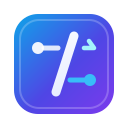

<div align="center">



# agy-cmd

**Google Antigravity 桌面端插件：按任务自动路由指令 · 测试未过自动续跑 · 确认计划实施自动调用多智能体 · 卡壳时自动换视角排查 · 防止偷偷改代码**

简体中文 · [English](README.md) · [怎么安装](#怎么安装-agy-cmd) · [核心功能](#agy-cmd-有哪些功能) · [命令行管理](#怎么用命令行管理)

</div>

---

## agy-cmd 是什么？

`agy-cmd` 是 **Google Antigravity 桌面版 / IDE** 的辅助插件。

安装以后，它会在你和 AI 对话时自动处理这几件事：

- **按不同任务自动路由指令**：根据任务范围自动匹配 `/grill-me`、`/plan`、`/run-workflow` 等内置能力；
- **测试未过自动续跑**：在测试或验证还没通过时让 AI 接着排查修复，不提前停工；
- **确认计划实施自动调用多智能体**：会员开启 Boost 后，批准方案或回复“按计划执行”即自动调度 `DeepCoder` / `DeepInvestigator` 执行与验收；
- **卡壳时自动换视角排查（全套餐可用）**：反复修错未果时，指示 AI 停止盲改并派独立只读子智能体（`dart-reviewer` / `research`）核查根因；
- **只读模式防绕过审批**：在只读模式拒绝写方案文件时，强制正文直接输出方案等你确认，严禁自动跳过审批偷偷改代码；
- **右侧可视化控制面板**：提供随时点选的控制面板，同时内置免费账号防报错保护，默认屏蔽未开通套餐的付费口令。

## 怎么安装 agy-cmd？

要安装打包好的稳定版，请从 [GitHub Releases](https://github.com/zou172866/Antigravity-agy-cmd/releases/latest) 下载 ZIP 并解压。在解压目录中，Windows 运行 `.\install.ps1`，macOS 或 Linux 运行 `sh ./install.sh`。

需要电脑已安装 Google Antigravity 桌面版、Node.js（20 及以上版本）和 Python 3。

打开终端，复制对应系统的一行命令运行，完成后重启或刷新 Antigravity 窗口即可使用。

**Windows（PowerShell 一行直装）：**

```powershell
irm https://raw.githubusercontent.com/zou172866/Antigravity-agy-cmd/main/install.ps1 | iex
```

**macOS / Linux（一行直装）：**

```bash
curl -fsSL https://raw.githubusercontent.com/zou172866/Antigravity-agy-cmd/main/install.sh | sh
```

也可以手动克隆仓库安装：

```powershell
git clone https://github.com/zou172866/Antigravity-agy-cmd "$HOME\.gemini\config\plugins\agy-cmd"
python "$HOME\.gemini\config\plugins\agy-cmd\skills\agy-cmd\scripts\setup_auto_router.py" --install
```

如果只安装基础文字规则（不含自动重试和右侧面板），可以运行：

```bash
npx -y skills add zou172866/Antigravity-agy-cmd -g --all
python ~/.agents/skills/agy-cmd/scripts/setup_auto_router.py --install --standalone
```

## 装好后先看哪两项设置？

为了防止免费账号误输付费口令报错，插件刚装好时默认开启「免费版保护」和「最多自动重试 3 次」。

安装完成后，请打开软件右侧边栏的「agy-cmd 自动路由」面板（也可以在聊天框点击 `sidecar://agy-cmd/panel/` 打开），确认两项设置：

1. **自动重试次数**：选择「不用重试（0 次）」「指定次数（1～50 次）」或「一直重试」。
2. **账号档位**：如果你开通了 Google AI Pro / Ultra 会员，可以切换到「Pro / Ultra 会员」，开启 Boost 自动接入。「计划获批后自动使用 Boost」默认开启。点击「批准」或在方案后回复“按计划执行”，插件会提示 `[agy-cmd → 计划获批，自动 Boost]` 并直接调度隐藏的 `DeepCoder` / `DeepInvestigator` 子智能体执行与验证，无需手动输入 `/boost`（仅在调用报错时才回退为普通工具执行），且后台任务唤醒不会重复触发。你可以单独关闭这个开关，保留卡壳时的 Boost 提醒。

## agy-cmd 有哪些功能？

### 1. 按任务大小自动分步骤

这项功能用于省去手动挑选内置命令的步骤。

- 改动 1～2 个文件、解释代码或查找内容时，AI 直接给出结果，不额外弹窗打扰。
- 需求没说清时，AI 先出一个选择题向你确认方向。
- 需要改动 3 个及以上文件时，AI 先把修改方案列出来，等你确认后再动手改代码。即使当前处于只读模式无法新建方案文件，AI 也会直接在对话框里写出方案等你点头；在会员 Boost 模式下，方案获批后会自动提示 `[agy-cmd → 计划获批，自动 Boost]` 并单次触发 `DeepCoder` / `DeepInvestigator` 执行，同时在后台任务唤醒时保留 `Stop` 自动续跑状态。
- 需要同时处理 5 个及以上同类文件或任务时，AI 会自动分头同时处理，节省等待时间。
- 需要操作网页或展示可点击的图表时，AI 会自动打开内置浏览器或生成交互画面。

### 2. 测试没过自动接着修

这项功能用于防止 AI 在报错还没修好时提前停工。

当你让 AI 改代码或修错，但测试、运行验证还没通过时，插件会自动让 AI 继续排查修改，直到验证通过或达到设定的重试上限。

在下面几种情况下，插件会自动放行并立即停下：

- 你只是提问（例如“为什么报错了”“帮我查查原因”“跑一下测试看看”），没有要求改代码；
- AI 刚把修改方案发给你，正在等你确认；
- AI 缺少必要信息，需要停下来问你；
- 你手动点击了停止按钮。

如果某一次提问想临时换用别的重试次数，直接在话里加上 `这次最多重试 5 次`、`这次一直重试` 或 `这次不用重试`，就只对当次提问生效。

### 3. 免费账号防报错与卡壳换思路

这项功能用于避免免费账号误触付费功能报错，并防止 AI 在同一个错上反复打转。

- **免费账号防报错**：Antigravity 中的 `/boost`、`/swarm`、`/teamwork` 属于付费会员口令，免费账号输入会报错。插件在默认免费模式下会自动隐藏这些口令提醒；切换到会员模式后才会提示。
- **卡壳换思路**：当命令连续失败 3 次，或者连改两次还是报同一个错时，插件会让 AI 先停下反复试错，重新检查报错原因后再给出办法。

### 4. 右侧面板与口令查询

这项功能用于随时查看和修改插件设置，或查询软件自带口令的用法。

- 在软件右侧「agy-cmd 自动路由」面板中点击按钮即可修改重试次数、触发方式和会员档位，点完立即生效。
- 在面板右上角可以点击 `★ Star` 前往 GitHub 仓库关注版本更新；累计帮你自动接着修满 3 次后也会提示一次，点击或关闭后不再重复弹出。
- 在聊天框直接输入“把自动重试改成 5 次”“开启 Boost 接入”或“列出 Antigravity 所有内置斜杠指令的区别”，AI 也会直接帮你改好或列出对比说明。

## 怎么用命令行管理？

除了点选右侧面板和在聊天框直接说以外，也可以在终端运行脚本管理设置：

```bash
# 查看插件状态与当前设置
python skills/agy-cmd/scripts/setup_auto_router.py --status

# 修改自动重试次数（可选 off / 1..50 / infinite）
python skills/agy-cmd/scripts/setup_auto_router.py --auto-retry off
python skills/agy-cmd/scripts/setup_auto_router.py --auto-retry 5
python skills/agy-cmd/scripts/setup_auto_router.py --auto-retry infinite

# 切换免费版或会员版
python skills/agy-cmd/scripts/setup_auto_router.py --plan-tier free
python skills/agy-cmd/scripts/setup_auto_router.py --plan-tier paid --boost on

# 检查插件文件是否完整
python skills/agy-cmd/scripts/setup_auto_router.py --sync-check

# 停用插件
python skills/agy-cmd/scripts/setup_auto_router.py --remove
```

运行自带测试：

```bash
npm test
python -m unittest discover -s test -p "test_*.py" -v
```
