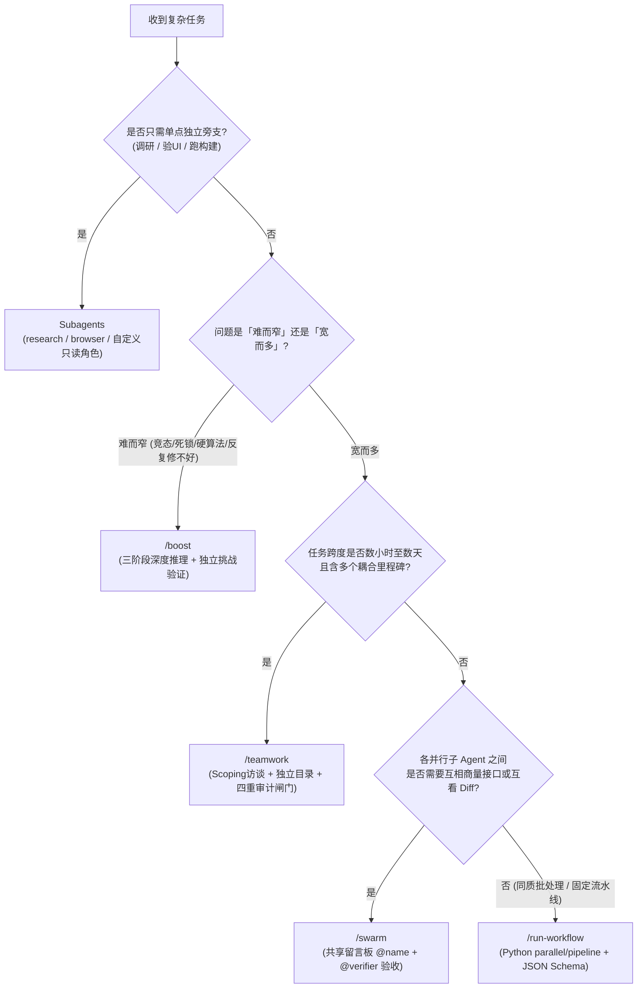

# Antigravity 多智能体调用时机、社区最佳实践与 `agy-cmd` 优化指南

> **调研日期**：2026-11-24
> **原始问题**：反重力（Google Antigravity）的 4 种多智能体分别应该在什么时候调用？社区最佳实践是什么？如何据此优化 `agy-cmd` 插件？
> **关联文档**：[free-tier-v2.3.md](../proposals/free-tier-v2.3.md) · [AGENTS.md](../../rules/AGENTS.md) · [desktop-commands-matrix.md](../../skills/agy-cmd/references/desktop-commands-matrix.md)

---

## 一、口径对齐与选型口诀

在 Google Antigravity 文档与社区语境中，“4 种多智能体”通常对应两种相近口径：

1. **官方横向对比表口径（4 大原生多智能体机制）**：`Subagents`（后台子智能体）、`/boost`、`/swarm`、`/teamwork`。
2. **显式斜杠命令口径（4 条多智能体命令）**：`/boost`、`/swarm`、`/teamwork`、`/run-workflow`（Dynamic Workflows），而把 `Subagents` 视为底层委派原语、把 `Orchestrator` 视为单会话双模型路由。

为消除盲区，本文按 **4 + 1 完整体系** 梳理（同时附带单会话基线 `Orchestrator`）。

### 选型速记

根据各工具的任务分工，本文将判断方法概括为：

> **“单点顺手外包 = `Subagents`；单个极难 Bug = `/boost`；多文件并行协作 = `/swarm`；同一件事批量重复 = `/run-workflow`；跨天多里程碑大工程 = `/teamwork`；其余日常任务 = 主对话 / `Orchestrator`。”**

---

## 二、官方 4 + 1 多智能体全维度对照表

以下信息核对自 2026-11-24 的 Antigravity 官方文档（`antigravity.google/docs/`）：

| 维度 | **Subagents**（后台子智能体） | **Boost (`/boost`)** | **Swarm (`/swarm`)** | **Teamwork (`/teamwork`)** | **Dynamic Workflows (`/run-workflow`)** |
| :--- | :--- | :--- | :--- | :--- | :--- |
| **核心定位** | 单点旁支任务后台委派 | **窄而深**：高难度逻辑、竞态、算法攻坚 | **宽且可拆**：多文件/多模块并行协作与交叉验收 | **大而长**：跨天、多里程碑、仓库级大工程 | **确定性批处理**：同质对象批量扫描或固定分阶段管线 |
| **触发方式** | 主 Agent 自动调用 `invoke_subagent`，或 `@subagent` | `/boost <task>`（立即启动） | `/swarm <task>`（立即启动） | `/teamwork <goal>`（先做 Scoping 访谈，批准后再跑） | `/run-workflow <task>` 或运行已保存 `.py` 脚本 |
| **协作拓扑** | 子任务通常向父对话汇报，已知 ID 的同级也能通信 | 三阶段流水线：`DeepCoder` / `DeepInvestigator` 初版 → 独立 Improvement Worker 攻防修补 → 主编排器抽检 | Coordinator 拆活 → 具名 Worker（`@parser` 等）+ `@verifier` + `@monitor` 在**共享留言板**用 `@name` 互通 | `Sentinel` + `Project Orchestrator`（里程碑间换新实例防上下文退化）+ `Explorers` + `Workers` | Python 脚本用 `parallel()` / `pipeline()` 调度多 Agent，**子 Agent 间不聊天、看不到脚本** |
| **验收 / 质检** | 父 Agent 自行核查子 Agent 回复 | 后续 Worker 专门试图攻破前序方案并实跑测试，主编排器按要求逐项抽查 | 可安排专职 `@verifier` 审 Diff 并实跑测试 | 四重独立对抗闸门：`Critic` → `Challenger` → `Auditor` → `Success Auditor` | 强制通过 `finish` 工具按 JSON Schema 回传结构化结果给脚本聚合 |
| **工作区隔离** | 默认 `inherit`，可显式选 `branch`（独立克隆/worktree）或 `share` | 同工作区，隔离子上下文 | 默认共享工作区；并行写入可给各 Worker 分配独立工作副本 | 专用目录（`~/teamwork_projects/{PROJECT}`）+ **文件独占所有权** + 独立 scratch 目录 | 默认 `inherit`，可为并行写手指定 `branch` / `share` |
| **典型时长** | 秒～数分钟 | 秒～数小时 | 数分钟～数小时 | 数小时～数天 | 数分钟～数小时 |
| **官方支持端** | App、CLI、IDE 扩展、Antigravity IDE | App、CLI、IDE 扩展、Antigravity IDE | **仅 App、CLI**（Preview） | App、CLI、IDE 扩展、Antigravity IDE | **仅 App、CLI** |
| **官方套餐门槛** | **全套餐** | **仅付费计划** | **全套餐**（但多 Worker 消耗配额极快） | **仅付费计划** | **全套餐** |

> **基线参照（单会话双模型 `Orchestrator`）**：不开启多智能体拓扑，而是在单一对话中由旗舰规划模型（如 `Gemini 4 Neon` / `Carbon` / `Argon` / `Claude Opus 5.5`）负责规划与审查，将常规工具调用路由给更快的执行模型（如 `Gemini 4 Hydrogen`）。普通账户可直接使用当前单会话模型。Orchestrator 面向符合条件的 Pro、Ultra 和 Gemini Enterprise 账户，以模型选择器显示为准。[官方模型说明](https://antigravity.google/docs/models#orchestrator)

---

## 三、分场景调用边界：何时用 vs 何时不用

### 1. Subagents（后台子智能体）
* **内置角色**：`research`（代码库调研）、`browser`（真实页面交互/截图/控制台排查）、`self`（克隆主 Agent），外加 `.agents/agents/`、`~/.gemini/config/agents/` 或插件自带的自定义角色。
* **该用**：不想打断或污染主对话上下文的单点委派（查一处复杂调用链、跑浏览器 UI 验收、请只读审阅者做一次 Diff 复核）。
* **不该用**：多个子任务之间需要频繁协商接口、或要多写手同时修改代码库。

### 2. `/boost`（深度推理与对抗修补）
* **内部机制**：Phase 1 判断走 `DeepCoder`（实现）还是 `DeepInvestigator`（根因分析）→ Phase 2 初版实现与测试 + 多轮 Improvement Worker 独立破防修复 → Phase 3 主编排器逐条核验原始需求。
* **该用**：问题**难而不广**——并发竞态/死锁、偶发 Flaky Test、复杂算法与 SIMD/性能优化、高耦合逻辑反复陷入局部死循环。
* **不该用**：简单语法错误、常规 1～2 文件小改（延迟和算力成本过高）；或几十个独立文件的横向铺开开发。

### 3. `/swarm`（共享留言板并行蜂群）
* **内部机制**：当前对话变身纯调度 Coordinator（自己不写代码，始终保持可响应），把不冲突的模块拆给具名 Worker；所有沟通公开写在留言板，空闲成员**零 Token 休眠**直到被 `@name` 唤醒；另有 `@monitor` 防全员静默卡死。
* **该用**：
  * **多文件并行实现**：如同时给 `users.ts` / `orders.ts` / `products.ts` 加校验和单测，每文件一个 Worker + 一个 `@verifier`；
  * **多包测试并行修复**：按包拆分失败用例，各修各的，最后统一唤醒 `@verifier` 跑全套；
  * **多路只读并行排查**：三路同时查启动慢的不同维度（导入、配置、插件），在留言板交叉印证后合并排序。
* **不该用**：改动高度集中在同一核心文件（合并冲突/反复打回）；或对 20+ 同质文件跑完全一样的机械检查（改用 `/run-workflow`）。

### 4. `/teamwork`（长周期里程碑工程团队）
* **内部机制**：
  * **Phase 1（Scoping 访谈）**：遵循 **“只定 What，不定 How”** 原则，确认目标、客观验证指标、验收标准、工作目录，以及 3 档完整性模式（`development` 允许复用库 / `demo` 禁抄核心逻辑禁偷看测试源码 / `benchmark` 仅用标准库从零实现），最终产出 Prompt Artifact 供一次审批。
  * **Phase 2（自主交付）**：支持 5 条自动执行路径（General 分布式编码 / Iterative 轻量迭代 / Document Review 文档多角度评审 / Math 证明 / Math 大型锦标赛），里程碑间由 `Project Orchestrator` 交接给全新实例防止长上下文退化。
* **该用**：数小时到数天的仓库级框架迁移（如 Express → Fastify）、复杂系统仿真、严谨基准评测、大规模科研/定理证明或重要 RFC 深度评审。
* **不该用**：一两小时能收工的常规开发任务（访谈与四重审计开销过重）。

### 5. `/run-workflow`（动态 Python 脚本工作流）
* **内部机制**：由内置 Python 运行时执行受审脚本，提供 `phase()`、`parallel()`、`pipeline()`、`agent()`、`trajectory()`、`call_tool()` 等原语；既支持一次性 `await agent(...)`，也支持保留上下文的多轮有状态 `a = agent(...)`（如“同一审阅者先找 Bug，等并行修复完再由同一审阅者复核”）。
* **该用**：**10+ 同质对象**重复执行相同规范（批量审查 PR 改动文件、逐包审计合规性、批量文稿质检），或需要保存为 `.py` 脚本长期复用的固定流水线。
* **与 `/swarm` 的核心分水岭**：子 Agent **需要边干边互相商量/互看 Diff** → `/swarm`；子 Agent **各自独立干完交结构化回执给脚本** → `/run-workflow`。

---

## 四、社区实战最佳实践与高频避坑清单

以下结合官方机制列出项目建议与常见失败情境。并发规模和配额收益尚未在本项目中做对照测量。

### 六大最佳实践

1. **Pre-flight 先在主对话定边界，再拉多智能体（最省配额）**
   * 模糊需求直接起 `/swarm` 或 `/teamwork`，会导致多个 Agent 并行做开放式检索，配额瞬间见底。
   * 最佳实践：先用单对话（或 `/grill-me` → `/plan`）敲定技术栈、接口契约、目标目录与测试命令，再把明确规范喂给多智能体。
2. **文件所有权严格正交 + 写操作隔离工作区**
   * 并行写代码的头号事故是“语义合并炸弹（多人同时改同一入口或配置）”。
   * 拆分任务必须按包/模块/文件正交切分，在 Prompt 中明确写清 **“拥有什么 + 禁止碰什么”**；多写手并行写入时使用独立工作副本（`share` / `branch`），而在 Windows 脏工作树或非 Git 项目上优先采用“单写手 + 只读复核”以规避合并风险。
3. **独立复核与跨模型验证**
   * 本项目建议从每 2～4 个 Worker 配 1 个独立 `@verifier` 起步，再根据审查量调整。官方支持为 Verifier 选择当前账户可用的另一模型；只有一个可选模型时，仍可由独立角色审查。[Swarm 模型选项](https://antigravity.google/docs/swarm/)
4. **模型分层混搭 + 利用零 Token 休眠控成本**
   * 旗舰强推理模型负责 Coordinator / Verifier / Architect，轻量快速模型跑常规执行 Worker 或大扇出扫描。
   * `/swarm` 的 `Waiting` 状态**零 Token 消耗**，任务未完全收口前无需急着 kill Worker。
5. **给足机器可检验的 “Done When” 验收条件**
   * 首条 Prompt 必须携带确定性验证命令与红线（如 `npm test`、`go test -race ./...`、“不得删改既有断言”），避免 `/boost`、`/swarm` 在主观标准上反复空转。
   * `/teamwork` 按任务性质选好 `development` / `demo` / `benchmark` 完整性模式，从机制上堵住“Mock 敷衍”或“照抄测试逆推”的作弊路径。
6. **Subagents 严控扁平层级（1～2 层）**
   * 平台对子智能体递归嵌套有 10 层硬上限，本项目建议先控制在 **1～2 层**以内；一旦协作链路变深，应切换为 `/swarm` 或 `/teamwork`。

### 五个高频深坑

| 踩坑点 | 现象与根因 | 规避措施 |
| :--- | :--- | :--- |
| **`/run-workflow` 上下文孤岛** | 脚本拉起的 `agent()` 既看不到 Python 脚本，也看不到同级 Agent；漏传上下文会直接幻觉或失败 | 每个子 Prompt 必须自包含；需要上游日志时用 `trajectory()` 提取切片传入 |
| **`parallel()` 连坐取消** | `parallel()` 中只要有 1 个 Agent 异常退出（或未调 `finish` / 不符合 Schema），整批其余 Agent 会被立即取消 | 用 `async def` 包装每项并捕获异常；大批量可按 3～5 项复用多轮 Worker 兼顾异常隔离与 Prompt Cache |
| **`/swarm` 配额暂停不自启** | 任一成员触发配额耗尽后只报错一次并进入暂停，**配额恢复后不会自动继续** | 需人工或 Coordinator 给该成员切换模型，或在留言板发新消息重新唤醒 |
| **`/boost` 杀鸡用牛刀 / `/teamwork` 过重** | 对简单 Bug 敲 `/boost` 或对小功能敲 `/teamwork`，引入冗长等待、访谈和高额 Token 开销 | 严格遵守“普通单对话 → Subagent → `/swarm` / `/run-workflow` → `/boost` → `/teamwork`”阶梯升级 |
| **自定义 Subagent 拼错工具名挂起** | 官方已知问题：自定义 `.md` 的 `tools` 列表若包含未映射或拼写错误的工具名，子智能体可能静默挂起 | 仅填经当前宿主实测核验的精确工具名；只读角色严禁混入 `run_command` 等通用执行工具 |

---

## 五、调研时的差距与优化建议

以下“现网问题”和行号记录的是 v2.2.1 调研基线。当前使用方法见 [README](../../README.zh-CN.md)。对照当时的仓库代码（[rules/AGENTS.md](../../rules/AGENTS.md)、[SKILL.md](../../skills/agy-cmd/SKILL.md)、[desktop-commands-matrix.md](../../skills/agy-cmd/references/desktop-commands-matrix.md)、[README.zh-CN.md](../../README.zh-CN.md)）及已拟定的 [free-tier-v2.3.md](../proposals/free-tier-v2.3.md)，梳理出 **6 项可直接落地的优化方向**：

### 优化 1：修正套餐门槛口径漂移，明确区分「平台权限」与「插件省配额策略」
* **现网问题**：
  * `desktop-commands-matrix.md`（L23-24、L54-55）仍将 `/swarm` 与 `/run-workflow` 标注为 `Google AI Pro / Ultra`；
  * `README.md` / `README.zh-CN.md`（L102）与 `SKILL.md`（L17）将 `/swarm` 归入“免费账号输入会报错的付费口令”；
  * `rules/AGENTS.md`（L10-11）对 `/run-workflow` 先出徽标再判降级，对 `/swarm` 写死“仅确认付费套餐可用时”。
* **优化方案**：
  * 将官方事实与插件策略解耦表述：**截至 2026-11-24，`/boost` 与 `/teamwork` 属于付费专属（免费会报错）；`/swarm` 与 `/run-workflow` 平台已对全套餐开放，但免费档周配额紧张且多 Worker 消耗极快，因此 `agy-cmd` 在默认免费安全模式下仍按“省配额保护”主动降级/抑制推荐**。[免费用户执行提案](../proposals/free-tier-v2.3.md)
  * 修正 `rules/AGENTS.md` L10 批处理路由顺序：免费或未确认开启重型并发时直接走分批处理，不先亮 `[agy-cmd → /run-workflow]` 徽标。

### 优化 2：补充宿主端（App / CLI / IDE）能力边界，避免 IDE 环境误推 `/swarm` 与 `/run-workflow`
* **现网问题**：`agy-cmd` 定位为“桌面端 App 与 IDE 通用”，但在最新官方文档中，**`/swarm` 与 `/run-workflow` 仅列出 `Antigravity App, Antigravity CLI`**，并未涵盖全部 IDE 扩展；而 `Subagents`、`/boost`、`/teamwork` 覆盖 App / CLI / IDE 扩展。
* **优化方案**：
  * 在 `desktop-commands-matrix.md` 速查表中新增「**支持端**」列，标注 `/swarm` 与 `/run-workflow` 为 `App / CLI`（与 `/generative_ui`、`/automation` 仅 App 类似），在 IDE 宿主下自动降级为单会话分批或 `Subagents`。

### 优化 3：在选型矩阵中补齐 `Subagents` 与 `Orchestrator`，并提炼三条分流判据
* **现网问题**：`desktop-commands-matrix.md` 的“自治与多智能体组”只有 `/goal`、`/boost`、`/swarm`、`/run-workflow`、`/teamwork` 5 行，缺少最常用的轻量底盘 **`Subagents`** 与 **`Orchestrator`**，用户问“多智能体该选哪个”时容易跳过轻量方案直接上重型命令。
* **优化方案**：
  * 扩展矩阵为 **“日常基线（Orchestrator）+ 轻量外包（Subagents）+ 5 档自治/多智能体命令”**。
  * 在 `SKILL.md` 模式 C（选型参谋）与 `desktop-commands-matrix.md` 中固化 **3 条快速排他判据**：
    1. **难而不广 vs 宽而独立** → `/boost` vs `/swarm`；
    2. **子 Agent 之间要不要互相对话/看 Diff** → `/swarm` vs `/run-workflow`；
    3. **单次任务（分钟～小时）vs 多里程碑跨天大工程** → `/swarm` vs `/teamwork`。

### 优化 4：把社区最佳实践注入“指令连招模板”与自动调度提示词
* **现网问题**：`desktop-commands-matrix.md` 第三节的连招模板目前只有 `/plan`、`/goal`、`/run-workflow`，缺少高质量的 `/swarm`、`/boost`、`/teamwork` 模板，且 `rules/AGENTS.md` 路由 `/swarm` 时仅写了“2～4 模块并行+验收”，未强调**文件正交、跨模型 Verifier、Pre-flight 契约**。
* **优化方案**：
  * **Pre-flight 前置约束**：明确“需求未清先 `/grill-me` → 多文件边界未定先 `/plan` → 范围正交后再进 `/swarm` / `/teamwork`”，防止一上来就并行烧额度。
  * **升级 `/swarm` 调度提示与模板**：
    * 强制检查各模块修改路径是否正交（禁止两 Worker 同改公共配置文件）；
    * 推荐 **每 2～4 个 Worker 配 1 个 `@verifier`**，并附带**跨模型验证**写法（如“用不同模型跑 `@verifier`，实跑测试且不得删减断言”）；
    * 提醒在 Windows 脏工作树/非 Git 仓库下慎用并行多写手（与 `free-tier-v2.3.md` 裁决 6 对齐）。
  * **升级 `/run-workflow` 调度提示**：在既有“3～5 项复用多轮 Worker + 单项异常隔离”基础上，补一条“每个 `agent()` Prompt 必须自包含上下文并定义严格 JSON Schema，避免上下文孤岛与 `parallel()` 连坐取消”。
  * **新增 `/boost` 与 `/teamwork` 高质量模板**：`/boost` 强调贴入复现步骤 + 确定性验证命令；`/teamwork` 提示用户在 Phase 1 明确目标验收指标与完整性模式（`development` / `demo` / `benchmark`）。

### 优化 5：面板控制项从单开关“Boost 开关”演进为更清晰的“并发与配额策略”（中长期可选）
* **现状**：右侧 Sidecar 面板目前只有「套餐档位（Free / Paid）」「Boost 自动接入」「自动重试次数」等控制项；`free-tier-v2.3.md` 已规划给免费档增加独立的「计划实施后独立复核（`freePlanReviewEnabled`）」。
* **演进建议**：
  * 短期（v2.3）：严格落实现有 [free-tier-v2.3.md](../proposals/free-tier-v2.3.md) 的两项交付（改后补验 + 可选单次纯只读复核），保持默认零新增子智能体，不盲目放开免费档 `/swarm` 多写手。
  * 中期（v2.4+）：若用户开通付费或愿意消耗免费配额，可在面板中将「多智能体主动路由偏好」解耦为独立开关（如：`仅轻量 Subagent` / `允许批处理 /run-workflow` / `允许并行 /swarm` / `允许会员 /boost & /teamwork`），用“配额开销预期”而非写死的套餐标签来引导用户决策。

### 优化 6：自定义只读复核角色的安全护栏（对接官方已知坑）
* 结合官方文档对自定义 Subagent 的警告（拼错 `tools` 会静默挂起）以及 `free-tier-v2.3.md` 的本机复核结论（`dart-reviewer` 含 `run_command`）：
  * 若 `agy-cmd` 后续打包静态只读角色（如 `cmd-verifier`），务必在 CI/安装自检中校验 `tools` 白名单仅含经目标宿主验证的只读/搜索工具，并在交接任务书中直接附带本次改动路径、关键 Diff 片段、适用 `AGENTS.md` 路径与主线程实跑命令结果，做到 **0 终端权限即可完成高质量独立复核**。

---

## 六、建议的下一步修改范围（供后续 `/plan` 参考）

调研时建议分两批推进。当前仓库已纳入路由说明、改后补验和可选只读复核；更细的面板配额开关属于后续设想。免费 App 与 IDE 的实际派工、权限与额外配额消耗仍待分别实测。

1. **第一批（纯规则、技能文案与矩阵对齐，零 Hook 逻辑风险）**：
   * [rules/AGENTS.md](../../rules/AGENTS.md) 与 [setup_auto_router.py](../../skills/agy-cmd/scripts/setup_auto_router.py) 内嵌规则同步：修正免费批处理路由顺序、补充 `/swarm` 文件正交与跨模型 Verifier 原则；
   * [SKILL.md](../../skills/agy-cmd/SKILL.md) 与 [desktop-commands-matrix.md](../../skills/agy-cmd/references/desktop-commands-matrix.md)：更新套餐门槛 vs 省配额说明、补充支持端列、补全 `Subagents` / `Orchestrator` 与 4+1 连招模板；
   * [README.md](../../README.md) 与 [README.zh-CN.md](../../README.zh-CN.md)：将免费版屏蔽 `/swarm` / `/run-workflow` 的解释同步为“节省周配额与防止付费口令报错”。
2. **第二批（功能代码演进）**：
   * 承接 [free-tier-v2.3.md](../proposals/free-tier-v2.3.md) 落地改后补验与可选只读复核；
   * 评估在 Sidecar 面板按“配额策略”细化重型多智能体路由开关。

---

## 七、参考来源

* **Google Antigravity 官方文档（2026-11-24 核验）**：
  * [Custom subagents](https://antigravity.google/docs/subagents)
  * [Boost deep reasoning (`/boost`)](https://antigravity.google/docs/boost)
  * [Swarm (`/swarm`)](https://antigravity.google/docs/swarm)
  * [Teamwork agent teams (`/teamwork`)](https://antigravity.google/docs/teamwork)
  * [Dynamic Workflows (`/run-workflow`)](https://antigravity.google/docs/dynamic-workflows)
* **社区调研线索**。原始笔记提及 Reddit 的 `r/google_antigravity` 与 Medium 开发者文章，未保留具体帖文链接。文中的经验建议由本项目归纳。
* **本仓库内部资料**：
  * [agy-cmd v2.3 普通用户执行提案](../proposals/free-tier-v2.3.md)
  * [agy-cmd 常驻路由规则](../../rules/AGENTS.md)
  * [桌面端与 IDE 指令深度辨析与速查矩阵](../../skills/agy-cmd/references/desktop-commands-matrix.md)

---

## 八、2026-11-26 架构蓝图增补与 v2.6.0 落地纪要

对照 *Gemini 4 Neon AI Agents Swarms* 实战蓝图（2026-11-26 核验汇总 Google Cloud 5 大编排模式、Gemini 4 三层定价与 6 组公开案例）与本机 Antigravity `swarm` 工具协议，补充以下实证结论，并在 `v2.6.0` 中完成落地：

1. **反并行实证与配额成本**：Google + MIT 实测显示，独立可拆分任务并行最高提升 **+80.8%**，但前后强依赖任务强行并行反而下降 **39%～70%**，两人编辑重叠代码成功率降低约 **30%**；实际只读 Swarm 消耗约为单会话的 **4～5 倍配额**。规则与技能层已新增负向否决门，严禁把强依赖改动拆进 Swarm。
2. **Swarm 全员继承 `AGENTS.md` 与 `hooks` 的隔离与前缀缓存保护**：Swarm Worker（含 `fork: "coordinator"` 分叉成员）共享全局规则、技能与钩子，且 Hydrogen 稳定前缀（≥4,096 token）可享 **95% 隐式缓存读折扣（\$0.075/M）**。`v2.6.0` 已在 `rules/AGENTS.md` 增加子智能体/Swarm 豁免条款，并在 `common.mjs` / `transcript.mjs` / `detector.mjs` 中补齐分叉 Worker 与活跃 Swarm Coordinator 识别，避免卡审批、误续跑或破坏共享前缀缓存。
3. **Orchestrator 双向回退与 Boost 阈值协同**：Orchestrator（默认 Neon 规划 + Hydrogen 执行，基准省约 24% 配额、提速 19%）在**验证失败 2 次**时原生交回 Neon 修补计划。`v2.6.0` 将付费自动 Boost 的 `edit↔fail` 震荡触发阈值上调至 **≥3 次**（免费档只读换视角仍维持 ≥2 次），避免抢跑打断 Orchestrator 低成本自愈。
4. **5 大研究编排模式与官方连招落地**：在 [desktop-commands-matrix.md](../../skills/agy-cmd/references/desktop-commands-matrix.md) 补齐 `/grill-me → /plan → /swarm execute our plan`、多视角只读评审团（比单清单多发现约 35% 缺陷）、只读首跑排障、Best-of-N 基准择优、Council of Models 匿名评议、Gemini 4 三层选模、自定义 Subagent `model` 仅支持档位（`inherit`/`flash`/`pro`）说明及启动前自检清单；同时在 [agents/cmd-verifier.md](../../agents/cmd-verifier.md) 正文强化相对路径 + 1-based 行号、禁删断言与真实命令输出硬要求。
